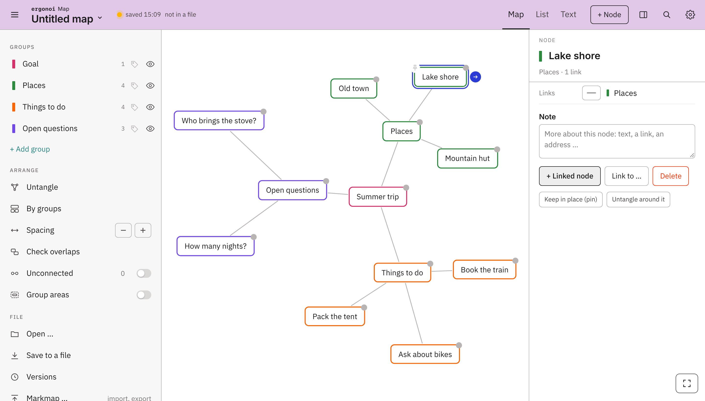

# ergonoi Map

An open mind map in a single HTML file.



Nodes in groups, links with or without direction, a note for every node. It runs in the browser without a server and loads nothing from the network. The map is kept in the browser and can be saved as a plain text file, one line per node.

- **Open the app:** https://ergonoi.github.io/ergonoi-map/ (can be installed as an app from there)
- **Manual:** [docs/manual.md](docs/manual.md)
- **Text format:** [docs/format.md](docs/format.md)
- **ergonoi:** https://ergonoi.com
- **ergonoi Agenda**, the planning journal of the same family: https://github.com/ergonoi/ergonoi-agenda

## What it does

- Map, List and Text: the same map drawn, as rows per group, and as text to edit
- Arrange by groups, untangle crossing links, adjust the spacing
- Versions in the browser, files to save and open, print and PDF
- Import and export of Markmap outlines
- Works on phones and computers, offline once loaded

## Building

`dist/outheis-map.html` and the site in `site/` are built from `src/map.src.html`:

```
python3 build.py
```

Browser tests: [test](test).

Author: Markus Schatzl
